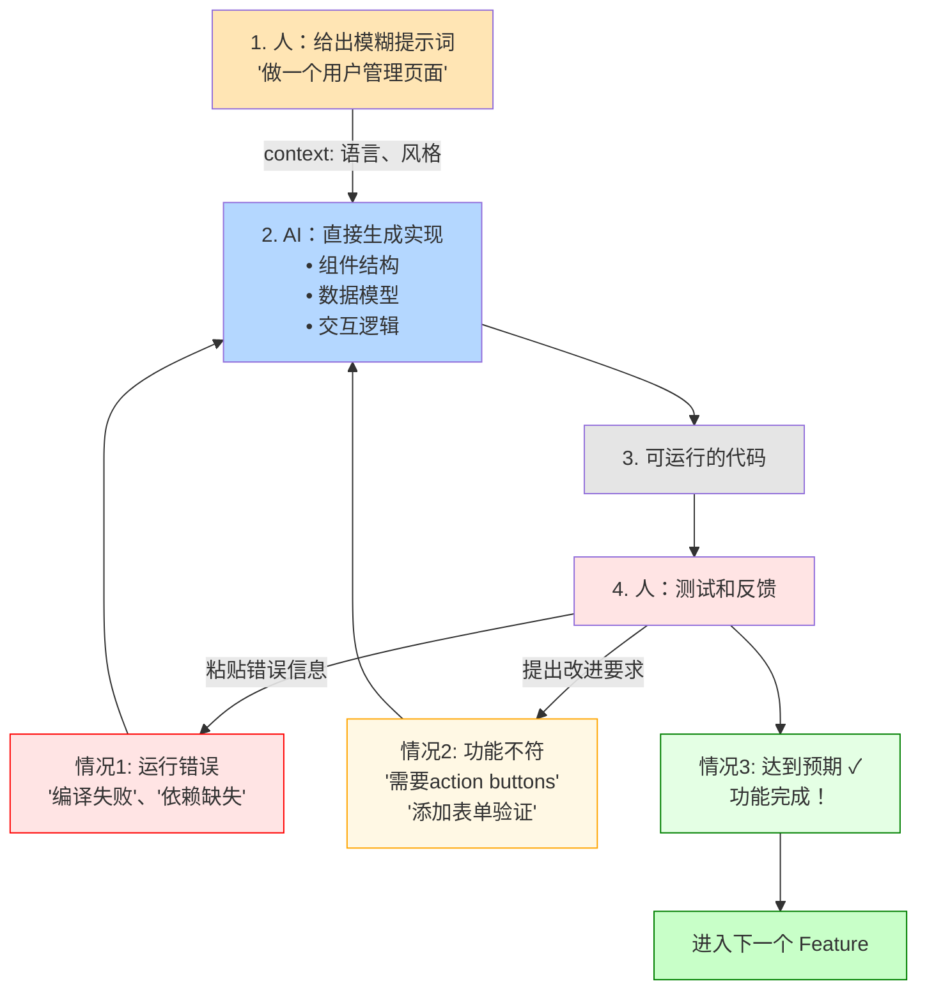
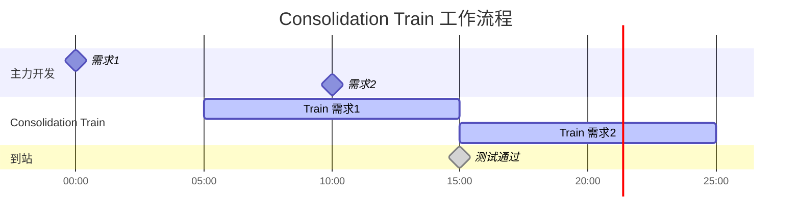

# 专业图表生成解决方案对比

## 当前问题
使用 Pillow (PIL) 绘制复杂流程图时，文字定位和布局控制困难，容易出现文字溢出、重叠等问题。

## 推荐解决方案（按推荐度排序）

---

## ⭐️ 方案 1: Mermaid.js（最推荐）

### 简介
- Mermaid 是专为 Markdown 设计的图表语言
- 语法简洁，渲染专业
- Hexo 有官方插件支持
- 支持流程图、序列图、甘特图等多种图表类型

### 优势
✅ **完美集成 Hexo**：直接在 Markdown 中编写，无需生成图片
✅ **自动布局**：智能计算文字和节点位置，无重叠问题
✅ **响应式**：自动适配不同屏幕尺寸
✅ **易于维护**：纯文本描述，版本控制友好
✅ **样式可定制**：支持 CSS 自定义样式
✅ **本地预览**：VS Code 有官方插件，实时预览

### 示例代码

#### Vibe Programming 流程图


#### Consolidation Train 流程图


### 安装和使用

```bash
# 安装 Hexo Mermaid 插件
npm install hexo-filter-mermaid-diagrams --save

# 在 _config.yml 中启用
mermaid:
  enable: true
  version: "10.6.0"
  options:
    theme: default
```

### 在文章中使用

```markdown
# 文章标题

这是流程图：

​```mermaid
flowchart LR
    A[开始] --> B[结束]
​```
```

---

## ⭐️ 方案 2: Graphviz + Python

### 简介
- Graphviz 是业界标准的图形可视化工具
- 强大的自动布局算法
- Python 有成熟的绑定库

### 优势
✅ **专业布局算法**：多种布局引擎（dot, neato, fdp, circo）
✅ **精确控制**：支持节点、边的细粒度定制
✅ **输出格式丰富**：PNG, SVG, PDF 等
✅ **文字不会溢出**：自动计算节点大小

### 示例代码

```python
from graphviz import Digraph

def create_vibe_programming_flow():
    dot = Digraph(comment='Vibe Programming 流程')
    dot.attr(rankdir='TB', size='8,10')
    
    # 设置节点样式
    dot.attr('node', shape='box', style='rounded,filled')
    
    # 添加节点
    dot.node('A', '1. 人：给出模糊提示词\n"做一个用户管理页面"', fillcolor='#FFE5B4')
    dot.node('B', '2. AI：直接生成实现\n• 组件结构\n• 数据模型\n• 交互逻辑', fillcolor='#B4D7FF')
    dot.node('C', '3. 可运行的代码', fillcolor='#E5E5E5')
    dot.node('D', '4. 人：测试和反馈', fillcolor='#FFE4E4')
    
    dot.node('E1', '情况1: 运行错误\n"编译失败"、"依赖缺失"', fillcolor='#FFE4E4', color='red')
    dot.node('E2', '情况2: 功能不符\n"需要action buttons"\n"添加表单验证"', fillcolor='#FFF8E4', color='orange')
    dot.node('E3', '情况3: 达到预期 ✓\n功能完成！', fillcolor='#E4FFE4', color='green')
    dot.node('F', '进入下一个 Feature', fillcolor='#C8FFC8', color='green')
    
    # 添加边
    dot.edge('A', 'B', label='context:\n语言、风格')
    dot.edge('B', 'C')
    dot.edge('C', 'D')
    dot.edge('D', 'E1', color='red', label='粘贴错误信息')
    dot.edge('D', 'E2', color='orange', label='提出改进要求')
    dot.edge('D', 'E3', color='green')
    dot.edge('E1', 'B', color='red')
    dot.edge('E2', 'B', color='orange')
    dot.edge('E3', 'F', color='green')
    
    # 渲染
    dot.render('vibe-programming-flow', format='png', cleanup=True)

if __name__ == '__main__':
    create_vibe_programming_flow()
```

### 安装

```bash
# macOS
brew install graphviz
pip3 install graphviz

# Ubuntu/Debian
sudo apt-get install graphviz
pip3 install graphviz
```

---

## ⭐️ 方案 3: diagrams (Python)

### 简介
- 专为架构图设计的 Python 库
- 支持云服务商图标（AWS, Azure, GCP）
- 代码即图表

### 优势
✅ **代码化**：用 Python 代码定义图表结构
✅ **丰富的图标库**：内置大量专业图标
✅ **自动布局**：智能排列节点
✅ **输出 PNG/SVG**：高质量图片

### 示例代码

```python
from diagrams import Diagram, Cluster, Edge
from diagrams.custom import Custom

with Diagram("Vibe Programming 流程", show=False, direction="TB"):
    with Cluster("迭代循环"):
        human = Custom("人：模糊提示", "./human_icon.png")
        ai = Custom("AI：生成代码", "./ai_icon.png")
        code = Custom("可运行代码", "./code_icon.png")
        test = Custom("测试反馈", "./test_icon.png")
        
        human >> Edge(label="需求") >> ai
        ai >> code >> test
        test >> Edge(label="修复", color="red") >> ai
        test >> Edge(label="完成", color="green") >> Custom("下一个功能", "./next_icon.png")
```

### 安装

```bash
pip3 install diagrams
```

---

## 方案 4: PlantUML

### 简介
- 专业的 UML 和流程图工具
- 文本描述，自动渲染
- 支持多种图表类型

### 优势
✅ **语法简洁**：类似 Mermaid
✅ **功能强大**：支持复杂的 UML 图表
✅ **跨平台**：基于 Java，到处可用

### 示例代码

```plantuml
@startuml
skinparam backgroundColor #EEEEEE
skinparam handwritten false

start
:1. 人：给出模糊提示词;
note right: 做一个用户管理页面
:2. AI：直接生成实现;
note right
  • 组件结构
  • 数据模型
  • 交互逻辑
end note
:3. 可运行的代码;
:4. 人：测试和反馈;

if (运行状态?) then (错误)
  :粘贴错误信息;
  note right #FFE4E4: 编译失败、依赖缺失
  backward:修复;
elseif (功能不符?) then (是)
  :提出改进要求;
  note right #FFF8E4: 需要action buttons
  backward:改进;
else (完成)
  :进入下一个 Feature;
  note right #E4FFE4: 功能完成 ✓
  stop
endif

@enduml
```

### 安装

```bash
# macOS
brew install plantuml

# 或使用在线服务
# http://www.plantuml.com/plantuml/
```

---

## 方案 5: Draw.io (Diagrams.net)

### 简介
- 免费的在线/离线流程图工具
- 可视化编辑，所见即所得
- 支持导出为多种格式

### 优势
✅ **可视化编辑**：拖拽创建，无需编程
✅ **模板丰富**：大量专业模板
✅ **导出格式多**：PNG, SVG, PDF, XML
✅ **离线可用**：桌面版和 VS Code 插件

### 使用方式

1. **在线版**：https://app.diagrams.net/
2. **桌面版**：`brew install --cask drawio`
3. **VS Code 插件**：Draw.io Integration

---

## 推荐方案总结

| 方案 | 推荐度 | 适用场景 | 优点 | 缺点 |
|------|--------|----------|------|------|
| **Mermaid** | ⭐️⭐️⭐️⭐️⭐️ | 博客、文档 | 完美集成、响应式、易维护 | 定制化程度有限 |
| **Graphviz** | ⭐️⭐️⭐️⭐️ | 复杂流程图 | 专业布局、精确控制 | 语法相对复杂 |
| **diagrams** | ⭐️⭐️⭐️⭐️ | 架构图、技术图 | 代码化、图标丰富 | 需要额外图标资源 |
| **PlantUML** | ⭐️⭐️⭐️ | UML 图表 | 功能全面、语法清晰 | 依赖 Java |
| **Draw.io** | ⭐️⭐️⭐️ | 快速原型 | 可视化、简单 | 不适合自动化生成 |

---

## 我的建议

### 对于你的博客场景，我强烈推荐：

1. **首选：Mermaid**
   - ✅ 直接在 Markdown 中编写，无需额外文件
   - ✅ Hexo 完美支持，一行配置即可启用
   - ✅ 自动布局，永远不会有文字溢出问题
   - ✅ 响应式，在手机上也能正常显示
   - ✅ 本地预览方便（VS Code 插件）
   - ✅ 文本格式，利于版本控制

2. **备选：Graphviz**
   - 如果需要更复杂的布局控制
   - 生成静态图片，加载速度快
   - 专业级布局算法

### 迁移成本

**Mermaid**: 最低
- 安装插件：5 分钟
- 转换现有图表：30 分钟
- 学习语法：1 小时

**Graphviz**: 中等
- 安装工具：10 分钟
- 编写脚本：1-2 小时
- 调试布局：1-2 小时

---

## 下一步行动

想要我帮你：
1. ✅ 安装和配置 Mermaid？
2. ✅ 将现有的 3 个图表转换为 Mermaid 语法？
3. ✅ 或者创建基于 Graphviz 的新版本？

选择你喜欢的方案，我立即帮你实现！
