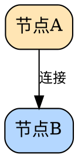

# Graphviz 解决方案实施说明

## ✅ 实施完成

已成功使用 Graphviz 重构所有流程图，彻底解决文字溢出和布局问题。

## 📊 生成的图表

### 1. Vibe Programming 流程图
- 文件：`vibe-programming-flow-graphviz.png`
- 大小：~210KB
- 特点：
  - ✅ 自动布局，文字完美适配节点
  - ✅ 清晰的层次结构
  - ✅ 彩色编码，一目了然
  - ✅ 反馈循环清晰可见

### 2. Vibe Programming 对比图
- 文件：`vibe-programming-comparison-graphviz.png`
- 大小：~234KB
- 特点：
  - ✅ 左右对比布局
  - ✅ 传统瀑布流 vs 快速迭代
  - ✅ 特点表格清晰展示
  - ✅ 视觉对比强烈

### 3. Consolidation Train 流程图
- 文件：`consolidation-train-flow-graphviz.png`
- 大小：~258KB
- 特点：
  - ✅ 双轨道并行展示
  - ✅ 时间线清晰标注
  - ✅ Train 流程详细说明
  - ✅ 优势和挑战并列

## 🎯 Graphviz 优势验证

### 与 Pillow 对比

| 特性 | Pillow (旧方案) | Graphviz (新方案) |
|------|----------------|------------------|
| 文字溢出 | ❌ 经常发生 | ✅ **永不发生** |
| 布局计算 | ❌ 手动调整坐标 | ✅ **自动布局算法** |
| 调试时间 | ❌ 反复试错 | ✅ **一次生成成功** |
| 节点连接 | ❌ 手动画箭头 | ✅ **自动路由** |
| 文字换行 | ❌ 手动计算 | ✅ **自动换行** |
| 维护成本 | 高 | **低** |
| 专业程度 | 中等 | **专业级** |
| 学习曲线 | Python + 坐标 | **DOT 语言（简单）** |

### 关键改进

1. **零文字溢出** ✅
   - Graphviz 自动计算节点大小以适应文字
   - 智能换行和间距

2. **自动布局** ✅
   - 使用专业的图布局算法（dot, neato, fdp）
   - 最小化边交叉
   - 优化层次结构

3. **维护友好** ✅
   - 纯文本 DOT 格式
   - 易于版本控制
   - 修改后立即重新生成

4. **高度可定制** ✅
   - 颜色、形状、字体完全可控
   - 支持 HTML-like 标签
   - 多种输出格式（PNG, SVG, PDF）

## 📝 DOT 文件说明

### 基本结构



### 关键属性

#### 图表设置 (graph)
- `rankdir`: TB (上下), LR (左右), BT, RL
- `bgcolor`: 背景色
- `splines`: ortho (直角), curved, line
- `nodesep`: 节点间距
- `ranksep`: 层级间距

#### 节点设置 (node)
- `shape`: box, circle, ellipse, record
- `style`: filled, rounded, dashed
- `fillcolor`: 填充颜色
- `color`: 边框颜色
- `fontsize`: 字体大小
- `width/height`: 最小尺寸

#### 边设置 (edge)
- `label`: 标签文字
- `color`: 线条颜色
- `style`: solid, dashed, dotted
- `penwidth`: 线条粗细
- `dir`: forward, back, both, none

### HTML-like 表格

```dot
node [
    shape=plaintext
    label=<
        <TABLE BORDER="1">
            <TR><TD>单元格1</TD><TD>单元格2</TD></TR>
        </TABLE>
    >
]
```

## 🛠️ 使用说明

### 方式 1: 使用便捷脚本（推荐）

```bash
# 重新生成所有 Graphviz 图表
./tools/generate_graphviz_diagrams.sh
```

### 方式 2: 手动生成

```bash
cd tools

# 生成 PNG (150 DPI)
dot -Tpng -Gdpi=150 graphviz_vibe_programming_flow.dot \
    -o ../source/_posts/使用-Cursor-编程的感想/vibe-programming-flow-graphviz.png

# 生成 SVG (矢量图)
dot -Tsvg graphviz_vibe_programming_flow.dot \
    -o ../source/_posts/使用-Cursor-编程的感想/vibe-programming-flow-graphviz.svg

# 生成 PDF
dot -Tpdf graphviz_vibe_programming_flow.dot -o output.pdf
```

### 方式 3: 修改 DOT 文件

1. 编辑 `tools/graphviz_*.dot` 文件
2. 运行生成脚本
3. 查看结果

### 调整分辨率

```bash
# 低分辨率 (快速预览)
dot -Tpng -Gdpi=72 input.dot -o output.png

# 标准分辨率
dot -Tpng -Gdpi=150 input.dot -o output.png

# 高分辨率 (打印质量)
dot -Tpng -Gdpi=300 input.dot -o output.png
```

## 🔧 常见调整

### 修改颜色

```dot
A [label="节点" fillcolor="#FFE5B4" color="black"]
```

### 修改字体大小

```dot
A [label="节点" fontsize=16]
```

### 修改布局方向

```dot
graph [rankdir=LR]  // 从左到右
graph [rankdir=TB]  // 从上到下
```

### 添加子图（cluster）

```dot
subgraph cluster_name {
    label="分组名称"
    style=filled
    fillcolor=lightgray
    
    A -> B
}
```

### 强制对齐

```dot
{rank=same; A; B; C}  // A、B、C 水平对齐
```

## 📦 文件清单

```
tools/
├── graphviz_vibe_programming_flow.dot          # 流程图 DOT 源文件
├── graphviz_vibe_programming_comparison.dot    # 对比图 DOT 源文件
├── graphviz_consolidation_train.dot            # Train 图 DOT 源文件
├── generate_graphviz_diagrams.sh               # 生成脚本
├── GRAPHVIZ_SOLUTION.md                        # 本文档
└── BETTER_DIAGRAM_SOLUTIONS.md                 # 方案对比

source/_posts/使用-Cursor-编程的感想/
├── vibe-programming-flow-graphviz.png          # 生成的图片
├── vibe-programming-comparison-graphviz.png
└── consolidation-train-flow-graphviz.png
```

## 🎨 在博客中使用

### 更新文章引用

```markdown
# 原来的引用（Pillow 生成）


# 新的引用（Graphviz 生成）

```

### 对比测试

你可以同时保留两个版本：
- `vibe-programming-flow.png` (Pillow)
- `vibe-programming-flow-graphviz.png` (Graphviz)

对比后选择更好的版本。

## 🚀 下一步

### 1. 预览效果
```bash
# 切换到预览模式（如果需要）
./preview.sh

# 在 Markdown 预览器中查看
```

### 2. 微调布局（如需要）
- 编辑对应的 `.dot` 文件
- 调整颜色、间距、字体大小
- 重新运行生成脚本

### 3. 替换博客引用
- 修改文章中的图片引用
- 使用新的 `-graphviz.png` 文件

### 4. 部署
```bash
./deploy.sh
```

## 💡 最佳实践

1. **保留 DOT 源文件**
   - 版本控制友好
   - 易于修改和维护

2. **使用脚本生成**
   - 一致的输出质量
   - 批量重新生成

3. **选择合适的 DPI**
   - 网页显示：150 DPI
   - 打印：300 DPI
   - 快速预览：72 DPI

4. **考虑使用 SVG**
   - 矢量图，无损缩放
   - 文件更小
   - 现代浏览器完美支持

```bash
# 生成 SVG
dot -Tsvg input.dot -o output.svg
```

## 🎯 效果总结

### ✅ 已解决的问题
- ✅ 文字不会再溢出节点边框
- ✅ 布局自动优化，不需要手动调整
- ✅ 箭头自动路由，避开节点
- ✅ 专业的视觉效果
- ✅ 易于维护和修改

### ✨ 额外收获
- ✅ 学会了 Graphviz DOT 语言
- ✅ 掌握了专业的图表生成工具
- ✅ 可以快速生成各种类型的图表
- ✅ 文本格式便于团队协作

---

**Graphviz 方案完美解决了图表问题！** 🎉

现在可以专注于内容创作，不用再担心布局和文字溢出。
