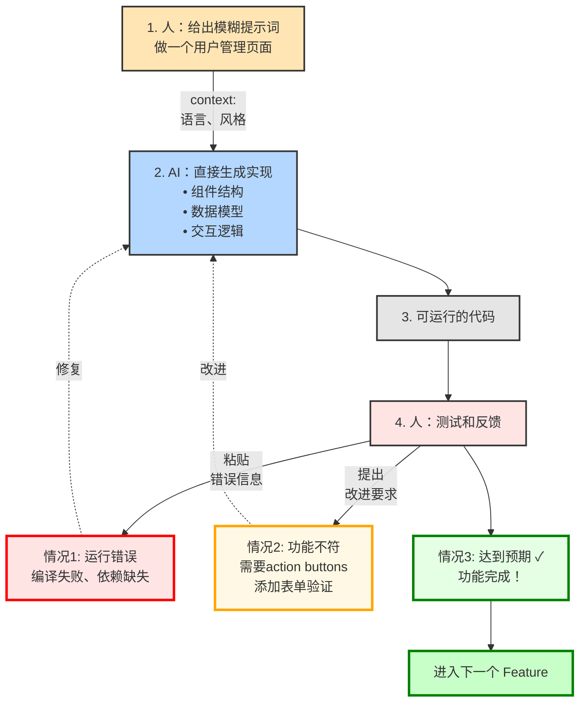
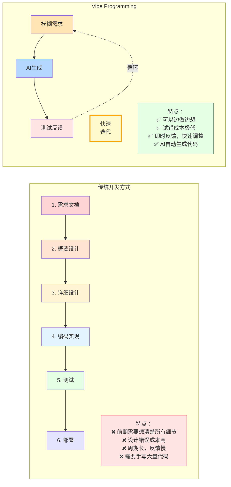
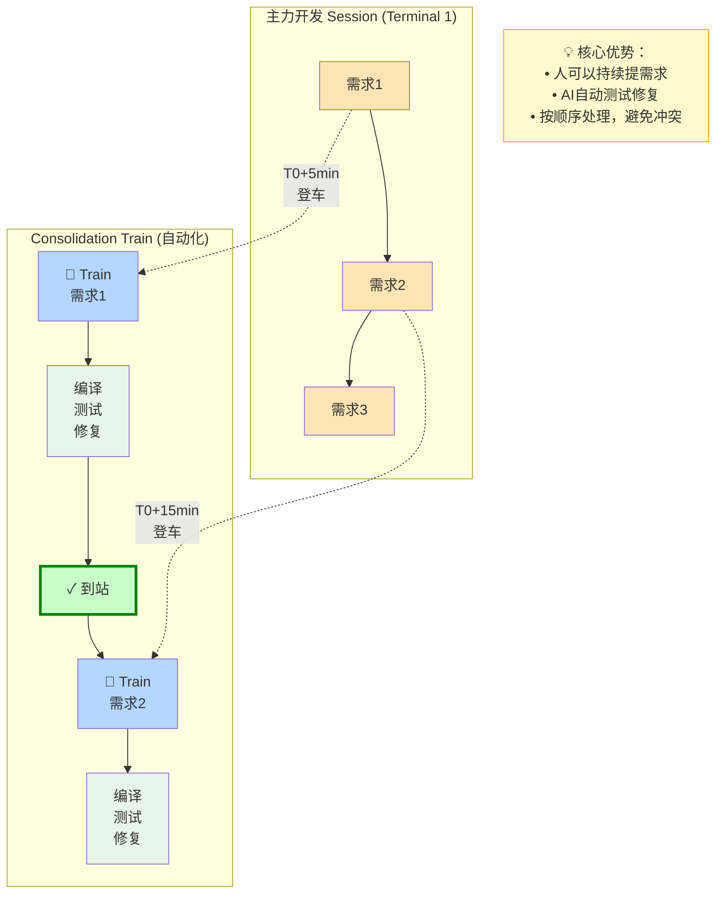

# Mermaid 版本的流程图示例

## 1. Vibe Programming 流程图



---

## 2. Vibe Programming 对比图



---

## 3. Consolidation Train 流程图

### 方式 A: 时间线风格

```mermaid
gantt
    title Consolidation Train 工作流程 - 双轨并行
    dateFormat HH:mm
    axisFormat %H:%M
    
    section 主力开发 Session
    提需求1 :milestone, req1, 00:00, 0m
    提需求2 :milestone, req2, 00:10, 0m
    提需求3 :milestone, req3, 00:15, 0m
    
    section Consolidation Train
    Train处理需求1 :active, train1, 00:05, 10m
    Train到站✓ :milestone, done1, 00:15, 0m
    Train处理需求2 :active, train2, 00:15, 10m
    Train到站✓ :milestone, done2, 00:25, 0m
```



### 方式 B: 流程图风格



---

## 在博客中使用

### 1. 安装插件
```bash
npm install hexo-filter-mermaid-diagrams --save
```

### 2. 配置 _config.yml
```yaml
# Mermaid 图表支持
mermaid:
  enable: true
  version: "10.6.0"
  options:
    theme: 'default'
```

### 3. 在文章中使用
直接在 Markdown 中写：

````markdown
---
title: 我的文章
---

这是流程图：


````

---

## VS Code 本地预览

安装插件即可实时预览：
- **Markdown Preview Mermaid Support**
- 或 **Mermaid Preview**

---

## 对比总结

| 特性 | Pillow (当前) | Mermaid |
|------|--------------|---------|
| 布局方式 | 手动计算坐标 | 自动布局 |
| 文字溢出 | ❌ 经常出现 | ✅ 永不出现 |
| 本地预览 | ❌ 需要运行脚本 | ✅ IDE 直接预览 |
| 响应式 | ❌ 固定尺寸 | ✅ 自适应 |
| 维护成本 | 高（改动需重新调试） | 低（改文本即可） |
| 文件格式 | PNG 图片 | 文本代码 |
| 版本控制 | 不友好 | 友好 |
| 加载速度 | 快（静态图） | 快（现代浏览器优化） |
| 学习曲线 | 需懂 Python + 坐标 | 简单语法 |

---

## 我的建议

**立即迁移到 Mermaid！**

理由：
1. ✅ 完全解决文字溢出问题
2. ✅ 大幅降低维护成本
3. ✅ 提升用户体验（响应式）
4. ✅ 本地预览更方便
5. ✅ 符合现代 Markdown 最佳实践

---

## 需要我帮你：

1. ✅ 安装和配置 Mermaid 插件？
2. ✅ 将现有 3 个图表转换为 Mermaid 语法？
3. ✅ 测试并部署到博客？

只需要 10-15 分钟，就能彻底解决图表问题！🚀
